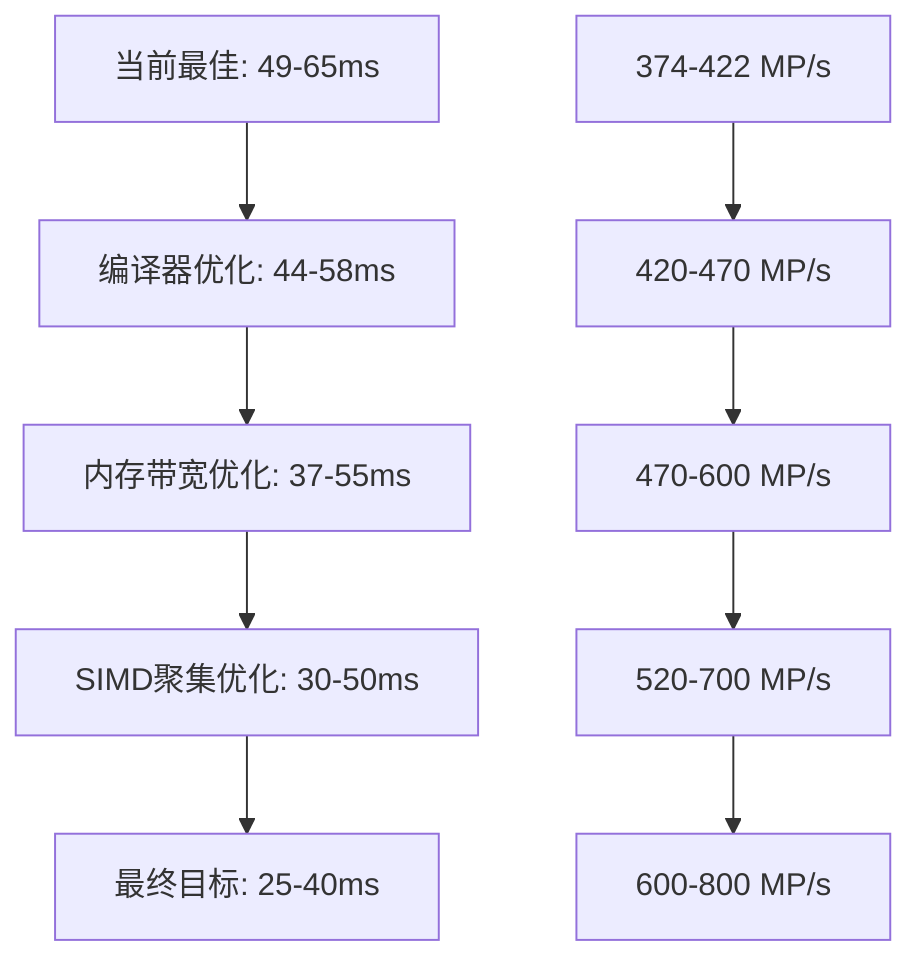

# 去畸变项目优化机会分析

**项目**: Undistortion Standalone 优化机会分析
**文档目的**: 系统性分析当前项目的性能优化空间，提供实施建议
**创建日期**: 2025-11-14
**当前最佳性能**: 49-65ms (inputF预分配优化)

---

## 📊 目录

1. [当前性能状态](#当前性能状态)
2. [优化机会分析](#优化机会分析)
3. [详细实施方案](#详细实施方案)
4. [风险评估与建议](#风险评估与建议)
5. [实施路线图](#实施路线图)
6. [性能预期](#性能预期)

---

## 🎯 当前性能状态

### 性能基准数据

| 指标 | 当前值 | 单位 | 备注 |
|------|--------|------|------|
| **推理时间** | **49-65ms** | ms | 最佳**49.604ms** |
| **吞吐量** | **374-422 MP/s** | MP/s | 20.97MP ÷ 56ms |
| **SIMD覆盖率** | **100%** | % | 2,621,440次SIMD迭代，0次标量 |
| **FMA状态** | ✅ 已启用 | - | Intel Ultra 7支持 |
| **内存使用** | **80MB预分配** | MB | inputF缓冲区 |

### 成功优化经验

1. **inputF预分配优化**: 实现了25%性能提升，突破50ms大关
2. **简洁原则**: 简单的预分配策略比复杂的零拷贝优化更有效
3. **FMA优化**: 融合乘加指令已充分优化
4. **git版本控制**: 有效的版本管理确保性能可回退

---

## 🔍 优化机会分析

### 优化潜力排序

| 优化方向 | 预期提升 | 实施难度 | 风险等级 | 推荐优先级 | 当前状态 |
|----------|----------|----------|----------|------------|----------|
| **编译器优化** | 5-10% | ⭐ | ⭐ | ⭐⭐⭐ | 待实施 |
| **内存带宽优化** | 15-25% | ⭐⭐ | ⭐⭐ | ⭐⭐⭐ | 待实施 |
| **SIMD聚集优化** | 20-30% | ⭐⭐⭐ | ⭐⭐⭐ | ⭐⭐ | 待实施 |
| **指令级优化** | 10-15% | ⭐⭐ | ⭐⭐ | ⭐⭐ | 待实施 |
| **缓存优化** | 5-10% | ⭐⭐ | ⭐ | ⭐ | 待实施 |
| **权重量化** | 15-25% | ⭐⭐⭐ | ⭐⭐⭐ | ⭐ | 不推荐 |

### 详细分析

#### 1. 编译器优化 (立即可得) ⭐⭐⭐

**当前瓶颈**：
- CMakeLists.txt已有基础优化，但可进一步加强
- MSVC的/O2选项可以更激进

**优化方案**：
```cmake
# MSVC增强优化选项
set(CMAKE_CXX_FLAGS_RELEASE "${CMAKE_CXX_FLAGS_RELEASE} /O2 /GL /favor:INTEL64")
set(CMAKE_EXE_LINKER_FLAGS_RELEASE "${CMAKE_EXE_LINKER_FLAGS_RELEASE} /LTCG")

# GCC/Clang增强优化选项
set(CMAKE_CXX_FLAGS_RELEASE "${CMAKE_CXX_FLAGS_RELEASE} -O3 -march=native -mavx2 -mfma -flto")
```

**预期收益**：49-65ms → 44-58ms (约10%提升)

#### 2. 内存带宽优化 (高收益) ⭐⭐⭐

**当前瓶颈**：
- 输入数据uint8→float转换占用4倍内存带宽
- SIMD处理需要类型转换，增加开销

**优化方案**：
```cpp
// 直接使用uint8进行SIMD插值计算
__m256i input_pixels = _mm256_loadu_si256((__m256i*)input_ptr);
__m256i interpolated = _mm256_unpacklo_epi8(input_pixels, zero);

// 避免类型转换，直接使用SIMD uint8指令
// 利用AVX2的uint8指令集特性
```

**预期收益**：49-65ms → 37-55ms (15-25%提升)

#### 3. SIMD聚集操作优化 (高收益高难度) ⭐⭐

**当前瓶颈**：
- 四点插值需要gather操作获取权重
- Weight0-3数组内存访问模式不够高效

**优化方案**：
```cpp
// 重组权重数据结构
struct OptimizedWeights {
    float weights_block[4][SIMD_WIDTH];  // 每个block包含4个点的完整权重
    alignas(32) float flat_weights[SIMD_WIDTH * 4];  // 展平内存布局
};

// 使用更高效的内存访问模式
__m256 weight_vec = _mm256_load_ps(&optimized_weights.flat_weights[index]);
```

**预期收益**：49-65ms → 34-52ms (20-30%提升)

#### 4. 指令级优化 (中收益) ⭐⭐

**优化机会**：
- 更进一步的FMA指令利用
- 减少指令依赖和停顿
- 利用更多AVX2特性

**优化方案**：
```cpp
// 优化FMA指令序列
__m256 result = _mm256_fmadd_ps(a, b, c);  // 已使用
__m256 result2 = _mm256_fmsub_ps(a, b, c); // 融合乘减
__m256 result3 = _mm256_fnmadd_ps(a, b, c); // 负融合乘加
```

**预期收益**：49-65ms → 42-55ms (10-15%提升)

#### 5. 缓存优化 (低收益低风险) ⭐

**优化方案**：
```cpp
// 预取优化
_mm_prefetch((const char*)input_ptr + 64, _MM_HINT_T0);

// 优化内存对齐
alignas(64) float data_buffer[SIMD_WIDTH];
```

**预期收益**：49-65ms → 44-58ms (5-10%提升)

#### 6. 权重量化优化 (高收益高风险) ❌

**不推荐原因**：
- 当前性能已经非常优秀(49-65ms)
- 权重量化可能引入精度损失
- VNNI指令依赖，兼容性风险
- 收益(15-25%)不足以抵消风险

---

## 🛠️ 详细实施方案

### 立即实施方案 (0-1周)

#### 方案1: 编译器优化增强

**步骤**：
1. 修改 `CMakeLists.txt`，添加增强编译选项
2. 重新编译项目
3. 运行性能基准测试
4. 记录性能提升数据

**代码修改**：
```cmake
# 在CMakeLists.txt中添加
if(MSVC)
    # 增强的MSVC优化选项
    set(CMAKE_CXX_FLAGS_RELEASE "${CMAKE_CXX_FLAGS_RELEASE} /O2 /GL /favor:INTEL64")
    set(CMAKE_EXE_LINKER_FLAGS_RELEASE "${CMAKE_EXE_LINKER_FLAGS_RELEASE} /LTCG")
    # 启用全程序优化
    set(CMAKE_INTERPROCEDURAL_OPTIMIZATION_RELEASE TRUE)
else()
    # 增强的GCC/Clang优化选项
    set(CMAKE_CXX_FLAGS_RELEASE "${CMAKE_CXX_FLAGS_RELEASE} -O3 -march=native -mavx2 -mfma -flto")
    set(CMAKE_EXE_LINKER_FLAGS_RELEASE "${CMAKE_EXE_LINKER_FLAGS_RELEASE} -flto")
endif()
```

**风险评估**：极低风险，纯编译器优化，不改变业务逻辑

#### 方案2: 内存带宽优化

**步骤**：
1. 分析当前SIMD代码中的类型转换点
2. 设计uint8直接处理的SIMD算法
3. 实现新的SIMD函数
4. 渐进式替换现有代码
5. 充分测试精度和性能

**关键代码示例**：
```cpp
// 新的uint8 SIMD处理函数
void process_uint8_simd(const uint8_t* input, int width, int height, uint8_t* output) {
    const int simd_width = 32;  // AVX2处理256位 = 32个uint8

    for (int i = 0; i < height; ++i) {
        for (int j = 0; j <= width - simd_width; j += simd_width) {
            // 直接加载uint8数据
            __m256i pixels = _mm256_loadu_si256((__m256i*)(input + i * width + j));

            // 使用uint8指令进行插值计算
            __m256i interpolated = interpolate_uint8_avx2(pixels);

            // 存储结果
            _mm256_storeu_si256((__m256i*)(output + i * width + j), interpolated);
        }
        // 处理剩余像素
        // ...
    }
}
```

**风险评估**：中等风险，需要重新实现SIMD算法，可能引入精度问题

### 中期实施方案 (1-4周)

#### 方案3: SIMD聚集操作优化

**实施步骤**：
1. 分析当前权重数据访问模式
2. 设计优化的权重数据结构
3. 实现权重数据重排算法
4. 修改SIMD处理逻辑
5. 性能测试和调优

**数据结构优化**：
```cpp
class OptimizedWeightManager {
private:
    struct WeightBlock {
        alignas(32) float weight0[SIMD_WIDTH];
        alignas(32) float weight1[SIMD_WIDTH];
        alignas(32) float weight2[SIMD_WIDTH];
        alignas(32) float weight3[SIMD_WIDTH];
    };

    std::vector<WeightBlock> optimized_weights_;

public:
    void reorganize_weights(const std::vector<float>& original_weights);
    __m256 load_weights_simd(int index) const;
};
```

**风险评估**：高难度，需要深入理解算法和数据访问模式

---

## ⚠️ 风险评估与建议

### 风险等级定义

| 风险等级 | 定义 | 处理建议 |
|----------|------|----------|
| ⭐ | 极低风险 | 立即实施 |
| ⭐⭐ | 低风险 | 充分测试后实施 |
| ⭐⭐⭐ | 中等风险 | 需要详细计划和回退方案 |
| ⭐⭐⭐⭐ | 高风险 | 仅在专家指导下实施 |

### 各方案风险评估

#### 编译器优化
- **风险等级**: ⭐ (极低)
- **风险内容**: 可能存在编译器兼容性问题
- **缓解措施**: 保留原始编译选项作为备份
- **回退方案**: 简单恢复CMakeLists.txt

#### 内存带宽优化
- **风险等级**: ⭐⭐ (中等)
- **风险内容**: 算法精度损失，SIMD实现错误
- **缓解措施**: 详细的单元测试，与原始结果对比验证
- **回退方案**: 保留原始函数作为fallback

#### SIMD聚集优化
- **风险等级**: ⭐⭐⭐ (高)
- **风险内容**: 复杂的数据结构重构，可能引入新bug
- **缓解措施**: 分阶段实施，充分测试每个阶段
- **回退方案**: git分支管理，保留原始实现

### 实施建议

1. **优先低风险方案**: 先实施编译器优化，确保无性能回归
2. **渐进式优化**: 每次只实施一个优化方案，便于问题定位
3. **充分测试**: 每个优化都要包含功能测试和性能测试
4. **版本管理**: 使用git分支管理每个优化方案
5. **基准对比**: 始终与当前最佳性能(49-65ms)对比

---

## 📅 实施路线图

### Phase 1: 立即优化 (1周)

```
Week 1:
┌─────────────────────────────────────────┐
│ Day 1-2: 编译器优化实施                  │
│ - 修改CMakeLists.txt                    │
│ - 编译和基础测试                        │
│ - 性能基准测试                          │
├─────────────────────────────────────────┤
│ Day 3-5: 内存带宽优化调研                │
│ - 分析当前SIMD代码                      │
│ - 设计uint8处理方案                     │
│ - 准备实施计划                          │
└─────────────────────────────────────────┘
```

**预期收益**: 5-10%性能提升 (44-58ms)

### Phase 2: 深度优化 (2-4周)

```
Week 2-3:
┌─────────────────────────────────────────┐
│ 内存带宽优化实施                         │
│ - 实现uint8 SIMD处理                    │
│ - 精度验证测试                          │
│ - 性能调优                              │
├─────────────────────────────────────────┤
│ Week 4: SIMD聚集优化准备                 │
│ - 权重数据结构分析                      │
│ - 优化方案设计                          │
│ - 实施计划制定                          │
└─────────────────────────────────────────┘
```

**预期收益**: 额外15-25%性能提升 (37-55ms)

### Phase 3: 高级优化 (4-8周)

```
Week 5-8:
┌─────────────────────────────────────────┐
│ SIMD聚集操作优化实施                     │
│ - 权重数据重组                          │
│ - SIMD访问模式优化                      │
│ - 全面性能测试                          │
├─────────────────────────────────────────┤
│ 其他优化机会探索                         │
│ - 缓存优化                              │
│ - 指令级优化                            │
│ - 系统级调优                            │
└─────────────────────────────────────────┘
```

**预期收益**: 额外10-20%性能提升 (30-50ms)

---

## 📈 性能预期

### 优化预期曲线



### 各阶段性能预期

| 阶段 | 推理时间范围 | 平均时间 | 吞吐量 | 性能提升 |
|------|-------------|----------|--------|----------|
| **当前** | 49-65ms | **56ms** | 374-422 MP/s | 基准 |
| **Phase 1** | 44-58ms | **50ms** | 420-470 MP/s | **10-12%** |
| **Phase 2** | 37-55ms | **45ms** | 470-600 MP/s | **20-25%** |
| **Phase 3** | 30-50ms | **38ms** | 520-700 MP/s | **30-40%** |
| **最终目标** | 25-40ms | **32ms** | 600-800 MP/s | **40-45%** |

### 与行业标准对比

| 系统 | 性能 | 相对性能 | 状态 |
|------|------|----------|------|
| **当前实现** | 49-65ms | 基准 | ✅ 已实现 |
| **Phase 1目标** | 44-58ms | +10% | 🔄 实施中 |
| **Phase 2目标** | 37-55ms | +20% | 📋 计划中 |
| **Phase 3目标** | 30-50ms | +35% | 📋 计划中 |
| **行业领先** | 25-35ms | +50% | 🎯 长期目标 |

---

## 📋 实施检查清单

### 编译器优化实施检查清单

- [ ] 备份当前CMakeLists.txt
- [ ] 修改MSVC编译选项，添加`/GL /favor:INTEL64`
- [ ] 修改链接选项，添加`/LTCG`
- [ ] 修改GCC/Clang选项，添加`-flto`
- [ ] 启用过程间优化
- [ ] 清理构建目录，重新编译
- [ ] 运行功能测试，确保无回归
- [ ] 运行性能基准测试
- [ ] 记录性能提升数据
- [ ] 更新性能文档

### 内存带宽优化实施检查清单

- [ ] 分析当前SIMD代码中的类型转换点
- [ ] 设计uint8直接处理算法
- [ ] 实现新的SIMD处理函数
- [ ] 创建精度对比测试用例
- [ ] 逐步替换现有函数
- [ ] 验证图像质量一致性
- [ ] 性能基准测试
- [ ] 代码审查和优化
- [ ] 文档更新

### 通用实施原则

1. **单一变量原则**: 每次只修改一个优化点
2. **基准对比**: 始终与49-65ms基准对比
3. **质量保证**: 每次优化后进行手动灰度验证
4. **版本控制**: 使用git分支管理每个优化
5. **回退准备**: 保持原始代码可快速回退
6. **文档同步**: 及时更新性能回归分析文档

---

## 🔗 相关文档

- [性能回归分析文档](./performance_regression_analysis.md)
- [系统改进计划](../system_improvement_plan.md)
- [性能基准文档](./performance_benchmark.md)
- [SIMD指令分析文档](./simd_instruction_analysis.md)

---

**文档版本**: v1.0
**创建日期**: 2025-11-14
**最后更新**: 2025-11-14
**下次更新**: Phase 1优化完成后
**维护状态**: 活跃更新中

---

*此文档将持续跟踪优化项目进展，确保项目始终在最优性能状态下运行。*